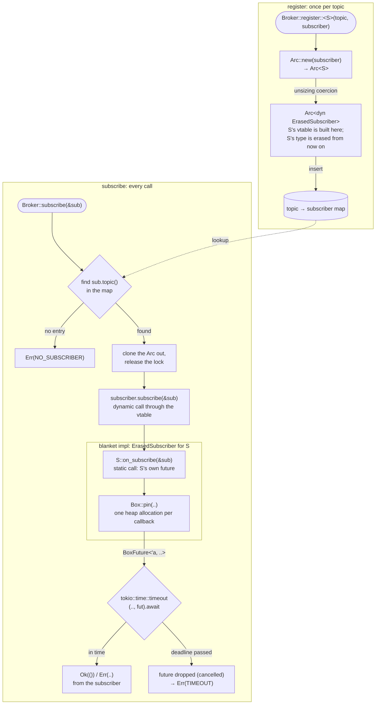

# erased-async-trait

A small, complete example of the **erased-trait pattern** for async traits in Rust:

- users implement a trait with plain `async fn`, with no macro and no boxing;
- the library still stores implementations of _different types_ side by side and calls them
  dynamically;
- the bridge between the two is a crate-private, dyn-compatible "erased" twin of the trait.

The domain is a tiny pub/sub broker. A `Subscriber` is told when a subscription to its topic is added
or removed, and can reject it. The broker holds one subscriber per topic as an
`Arc<dyn ErasedSubscriber>`.

```rust
use erased_async_trait::{Broker, Rejection, Subscriber, Subscription};

struct Audit;

impl Subscriber for Audit {
    async fn on_subscribe(&self, sub: &Subscription) -> Result<(), Rejection> {
        let user = sub.param("user").ok_or_else(|| Rejection::new("MISSING_USER", sub.id()))?;
        tokio::task::yield_now().await; // `sub` and `user` are still borrowed here
        println!("{user} subscribed to {}", sub.topic());
        Ok(())
    }
}

broker.register("admin", Audit);
broker.subscribe(&Subscription::new("s1", "admin").with_param("user", "ada")).await?;
```

## Contents

1. [The problem](#1-the-problem)
2. [Why the trait can't be a trait object](#2-why-the-trait-cant-be-a-trait-object)
3. [The pattern](#3-the-pattern)
4. [The call path](#4-the-call-path)
5. [Lifetimes: borrowing across `.await`](#5-lifetimes-borrowing-across-await)
6. [`Send`](#6-send)
7. [Forwarding through `Arc`](#7-forwarding-through-arc)
8. [Visibility: keeping the twin private](#8-visibility-keeping-the-twin-private)
9. [Cancellation](#9-cancellation)
10. [Costs and alternatives](#10-costs-and-alternatives)
11. [Layout, running, and what each test proves](#11-layout-running-and-what-each-test-proves)
12. [References](#12-references)

## 1. The problem

Since Rust 1.75, traits can declare `async fn` and return-position `impl Trait` (RPITIT). That gives
implementors the nicest possible syntax:

```rust
impl Subscriber for Audit {
    async fn on_subscribe(&self, sub: &Subscription) -> Result<(), Rejection> { /* ... */ }
}
```

But a library that keeps _many_ subscribers of _different_ types, one per topic, wants to store
them in one collection, which in Rust means a trait object: `Arc<dyn Subscriber>`. That doesn't
compile:

```text
error[E0038]: the trait `Subscriber` is not dyn compatible
   |
15 | pub fn store(subscriber: Arc<dyn Subscriber>) -> Arc<dyn Subscriber> {
   |                              ^^^^^^^^^^^^^^ `Subscriber` is not dyn compatible
   |
note: for a trait to be dyn compatible it needs to allow building a vtable
      for more information, visit <https://doc.rust-lang.org/reference/items/traits.html#dyn-compatibility>
    |
101 |     ) -> impl Future<Output = Result<(), Rejection>> + Send + 'a {
    |          ^^^^^^^^^^^^^^^^^^^^^^^^^^^^^^^^^^^^^^^^^^^^^^^^^^^^^^^^ the trait is not dyn compatible because method `on_subscribe` references an `impl Trait` type in its return type
```

(The real compiler output for this crate, trimmed.)

## 2. Why the trait can't be a trait object

A trait object `dyn Trait` is called through a **vtable**: a static table of function pointers, one
per method, built for each concrete type. Every caller of `dyn Trait` uses the same table layout, so
each entry needs **one fixed signature**, including its return type.

`async fn on_subscribe(..)` is sugar for `fn on_subscribe(..) -> impl Future<Output = ..>`. The
compiler generates a different anonymous future type for every implementation: `Audit`'s
`on_subscribe` returns one type, `Roster`'s returns another, and they have different sizes. There is
no single return type to put in the vtable, so `dyn Subscriber` can't exist.

Boxing fixes this. `Pin<Box<dyn Future<Output = T> + Send + 'a>>` is **one** type (a pointer)
whatever future is inside, so a method returning it _can_ sit in a vtable. The pattern puts the
boxing in a second, private trait so users never write it.

## 3. The pattern

Four pieces.

**① The public, ergonomic trait** (`src/subscriber.rs`). Methods return `impl Future + Send`, with
default bodies:

```rust
pub trait Subscriber: Send + Sync + 'static {
    /// A subscription was requested. Returning an error rejects it.
    fn on_subscribe<'a>(
        &'a self,
        _sub: &'a Subscription,
    ) -> impl Future<Output = Result<(), Rejection>> + Send + 'a {
        async { Ok(()) }
    }

    /// A subscription was removed. Cannot fail.
    fn on_unsubscribe<'a>(
        &'a self,
        _sub: &'a Subscription,
    ) -> impl Future<Output = ()> + Send + 'a {
        async {}
    }
}
```

**② The crate-private, dyn-compatible twin** (`src/erased.rs`). Same operations, but every method
returns one fixed type:

```rust
/// A heap-allocated, type-erased future borrowing for `'a`.
pub(crate) type BoxFuture<'a, T> = Pin<Box<dyn Future<Output = T> + Send + 'a>>;

pub(crate) trait ErasedSubscriber: Send + Sync {
    fn subscribe<'a>(&'a self, sub: &'a Subscription) -> BoxFuture<'a, Result<(), Rejection>>;

    fn unsubscribe<'a>(&'a self, sub: &'a Subscription) -> BoxFuture<'a, ()>;
}
```

**③ The bridge: a blanket impl.** Every `Subscriber` is automatically an `ErasedSubscriber`. Each
method calls the subscriber's own future (static dispatch) and boxes it once:

```rust
impl<T: Subscriber> ErasedSubscriber for T {
    fn subscribe<'a>(&'a self, sub: &'a Subscription) -> BoxFuture<'a, Result<(), Rejection>> {
        Box::pin(self.on_subscribe(sub))
    }

    fn unsubscribe<'a>(&'a self, sub: &'a Subscription) -> BoxFuture<'a, ()> {
        Box::pin(self.on_unsubscribe(sub))
    }
}
```

**④ Storage as a trait object of the twin** (`src/broker.rs`). The public entry point is generic,
and the type erasure happens inside it:

```rust
pub struct Broker {
    subscribers: Mutex<HashMap<String, Arc<dyn ErasedSubscriber>>>,
    timeout: Duration,
}

impl Broker {
    pub fn register<S: Subscriber>(&self, topic: impl Into<String>, subscriber: S) {
        // Unsizing coercion: Arc<S> becomes Arc<dyn ErasedSubscriber>, and the
        // compiler builds S's vtable for ErasedSubscriber here. From now on
        // S's type is erased.
        let subscriber: Arc<dyn ErasedSubscriber> = Arc::new(subscriber);
        self.subscribers
            .lock()
            .unwrap()
            .insert(topic.into(), subscriber);
    }
}
```

The naming follows the usual convention for this pattern (as in `erased-serde`): the twin is
`Erased<Trait>` because it is the type-erased form of `<Trait>`. `dynosaur` generates the same idea
under the name `Dyn<Trait>`.

## 4. The call path

```text
register::<S>("orders", subscriber)
  └─ Arc::new(subscriber)                         Arc<S>
       └─ coerced to Arc<dyn ErasedSubscriber>    fat pointer: (data ptr, vtable ptr)
                                                  S's vtable for ErasedSubscriber is built here,
                                                  from the blanket impl

subscribe(&sub)
  └─ self.subscriber("orders")                    clone the Arc out, release the lock
  └─ subscriber.subscribe(&sub)                   ① dynamic call through the vtable
       └─ <S as Subscriber>::on_subscribe(&sub)   ② static call: returns S's own future
       └─ Box::pin(..)                            ③ one heap allocation per callback
  └─ tokio::time::timeout(self.timeout, fut).await
       ├─ Ok(result)  → the subscriber's Ok / Err(Rejection)
       └─ Err(Elapsed) → TIMEOUT; the future is dropped (cancelled)
```

As a visual flow-chart:



There are two layers of dynamic dispatch per call: the subscriber is reached through the
`dyn ErasedSubscriber` vtable, and the future it returns is a second trait object
(`dyn Future`), polled through its own vtable. `Arc<dyn ErasedSubscriber>` is two words wide; the
unit test `a_stored_subscriber_is_a_fat_pointer` checks this.

## 5. Lifetimes: borrowing across `.await`

The returned future borrows `self` _and_ `sub`. Both parameters share the lifetime `'a`, and so does
the future:

```rust
fn on_subscribe<'a>(&'a self, sub: &'a Subscription) -> impl Future<..> + Send + 'a
```

That says "the future may hold `sub` for as long as it runs". It is sound because the broker awaits
the future while the caller's `sub` is still alive. So an implementation can keep a borrow of `sub`
across any number of awaits:

```rust
async fn on_subscribe(&self, sub: &Subscription) -> Result<(), Rejection> {
    let topic: &str = sub.topic();                       // borrowed from `sub`...
    tokio::time::sleep(Duration::from_millis(10)).await; // ...and held across this await
    self.by_topic.lock().unwrap().entry(topic.to_string()).or_default().push(sub.id().to_string());
    Ok(())
}
```

Two details make this pleasant:

- **Implementors never write `'a`.** `async fn on_subscribe(&self, sub: &Subscription)` gets two
  independent elided lifetimes, which is _more general_ than the trait's single `'a`. The compiler
  accepts the more general signature.
- **Getting it wrong is a compile error, not a runtime bug.** If the trait left `sub` unbound
  (`sub: &Subscription` with the future bounded only by `'a`), the future couldn't borrow it, and
  every implementation would have to clone first: `let sub = sub.clone(); Box::pin(async move { .. })`.
  Trying to borrow instead fails:

  ```text
  error: lifetime may not live long enough
    |
  8 |     fn on_subscribe<'a>(&'a self, sub: &Subscription) -> Pin<Box<dyn Future<Output = ()> + Send + 'a>> {
    |                     --                 - let's call the lifetime of this reference `'1`
    |                     |
    |                     lifetime `'a` defined here
  9 |         Box::pin(async move { let _ = &sub.0; })
    |         ^^^^^^^^^^^^^^^^^^^^^^^^^^^^^^^^^^^^^^^^ method was supposed to return data with lifetime `'a` but it is returning data with lifetime `'1`
  ```

The test `the_callers_reference_reaches_the_subscriber_unchanged` checks the end result: through the
broker, the erased adapter and the `Arc` forwarding impl, the subscriber receives the caller's own
`&Subscription` (the same address), not a copy.

## 6. `Send`

The futures are declared `+ Send`, so a broker can run them on a multi-threaded runtime, and callers
can `tokio::spawn(broker.subscribe(..))`. With RPITIT, the bound is **checked at each `impl`**: a
subscriber whose future isn't `Send` fails to compile right where it is written, not at some distant
`spawn`.

The usual mistake is holding a `std::sync::MutexGuard` (which is `!Send`) across an `.await`:

```rust
async fn on_subscribe(&self, _sub: &Subscription) -> Result<(), Rejection> {
    let mut count = self.0.lock().unwrap();
    tokio::task::yield_now().await; // the guard lives across this await
    *count += 1;
    Ok(())
}
```

```text
error: future cannot be sent between threads safely
  |
7 |     async fn on_subscribe(&self, _sub: &Subscription) -> Result<(), Rejection> {
  |                                                          ^^^^^^^^^^^^^^^^^^^^^ future returned by `on_subscribe` is not `Send`
  |
  = help: within `impl Future<Output = Result<(), Rejection>>`, the trait `Send` is not implemented for `std::sync::MutexGuard<'_, u64>`
note: future is not `Send` as this value is used across an await
  |
8 |         let mut count = self.0.lock().unwrap();
  |             --------- has type `std::sync::MutexGuard<'_, u64>` which is not `Send`
9 |         tokio::task::yield_now().await;
  |                                  ^^^^^ await occurs here, with `mut count` maybe used later
note: required by a bound in `Subscriber::on_subscribe::{anon_assoc#0}`
```

Fixes: release the guard before the `.await` (`*self.0.lock().unwrap() += 1;` drops it at the `;`),
or use `tokio::sync::Mutex` when the lock really must be held across an await. Both versions are
doctests in `src/lib.rs` (the broken one is a `compile_fail` doctest).

The broker follows the same rule internally: `Broker::subscriber` clones the `Arc` out of the map
and releases the std `Mutex` _before_ awaiting the callback.

## 7. Forwarding through `Arc`

Sharing one subscriber between topics means registering an `Arc` of it:

```rust
let roster = Arc::new(Roster::default());
broker.register("orders", roster.clone());
broker.register("payments", roster.clone());
```

That works because `Arc<T>` implements `Subscriber` by forwarding:

```rust
impl<T: Subscriber> Subscriber for Arc<T> {
    fn on_subscribe<'a>(
        &'a self,
        sub: &'a Subscription,
    ) -> impl Future<Output = Result<(), Rejection>> + Send + 'a {
        (**self).on_subscribe(sub)
    }
    // on_unsubscribe likewise
}
```

Because the return type is `impl Future`, the forwarding impl returns the inner subscriber's future
**as is**: no extra box, and no clone of `sub`. In the broker, the stored value is then
`Arc<Arc<Roster>>` behind the trait object, and a call still costs exactly one box (the adapter's).

Compare `#[async_trait]`, where every method returns a box: the same forwarding impl boxes the outer
call _and_ the inner one, two allocations per call.

## 8. Visibility: keeping the twin private

`ErasedSubscriber` and `BoxFuture` are `pub(crate)`: visible everywhere inside this crate, invisible
outside it. `lib.rs` re-exports only `Broker`, `Subscriber`, `Subscription`, `Rejection`,
`NO_SUBSCRIBER` and `TIMEOUT`.

- **No public signature mentions it.** `Broker::register<S: Subscriber>` names only the public trait;
  the conversion to `Arc<dyn ErasedSubscriber>` happens in its body. The `subscribers` field is
  private.
- **The compiler guards this.** If a public item did expose the private trait, the
  `private_interfaces` lint (warn by default) would flag it:

  ```text
  warning: trait `Erased` is more private than the item `leak`
    |
  2 | pub fn leak(_: &dyn Erased) {}
    | ^^^^^^^^^^^^^^^^^^^^^^^^^^^ function `leak` is reachable at visibility `pub`
    |
  note: but trait `Erased` is only usable at visibility `pub(crate)`
  ```

- **The blanket impl applies to user types but is unusable outside.** `Audit` technically implements
  `ErasedSubscriber`, but no other crate can name the trait, so none can call `.subscribe()` on it.

What this buys: the twin is an implementation detail. It can be renamed, given new methods, or
replaced (for example by `dynosaur`) without a breaking change. The public contract is only
`Subscriber` and `Broker::register`.

## 9. Cancellation

A Rust future does nothing until polled, and **dropping it cancels it**: execution stops at the
`.await` where it is suspended, the code after that point never runs, and its locals are dropped
(destructors run). The broker relies on this for timeouts:

```rust
match tokio::time::timeout(self.timeout, subscriber.subscribe(sub)).await {
    Ok(result) => result,
    Err(_) => Err(self.timed_out("on_subscribe", sub)),
}
```

When the deadline passes, `timeout` returns `Err(Elapsed)` and the callback's boxed future is
dropped. The same happens when the _caller_ gives up: a task running `broker.subscribe(..)` that is
aborted, or a `subscribe` future that loses a `tokio::select!` race.

What this means for implementors:

- keep state consistent at every `.await`, because any of them can be the last one that runs;
- use guards (`Drop`) for cleanup that must happen on cancellation;
- work you `tokio::spawn` from a callback is _not_ cancelled with it: it keeps running and may overlap
  the next callback.

The tests prove cancellation with a drop guard: a stalled callback holds a value whose `Drop` sets a
flag, and each test checks the flag after a timeout, an abort, and a lost `select!`.

## 10. Costs and alternatives

**Runtime cost.** Through the broker, each callback costs one heap allocation (the `Box`) and two
dynamic calls (the subscriber's vtable, then the future's). That is the same as `#[async_trait]`.
Calling a subscriber on its concrete type (`roster.on_subscribe(&sub).await`) uses static dispatch
and no allocation at all. The gains of the pattern are in ergonomics and correctness, not speed:

- implementors write plain `async fn`;
- they can borrow arguments across `.await`;
- `Send` is checked where the code is written;
- `Arc` forwarding is free.

**Alternatives**, and when to pick them:

| Approach                                         | What it does                                                            | Pick it when                                                                                  |
| ------------------------------------------------ | ----------------------------------------------------------------------- | --------------------------------------------------------------------------------------------- |
| This pattern (hand-written erased twin)          | Public RPITIT trait plus a private boxing twin                          | You need heterogeneous storage, want plain `async fn` for users, and want no extra dependency |
| [`dynosaur`](https://docs.rs/dynosaur)           | Generates the dyn-compatible `Dyn<Trait>` type from an attribute        | Same goal, but you'd rather generate the twin than maintain it (the generated type is public) |
| [`async-trait`](https://docs.rs/async-trait)     | A macro that rewrites every method to return a boxed future             | You need `dyn Trait` directly and accept boxing every call, even static ones                  |
| [`trait-variant`](https://docs.rs/trait-variant) | Generates a `Send` variant of an RPITIT trait                           | You need `Send` bounds on an async trait but not `dyn` dispatch                               |
| Enum dispatch                                    | An enum over the known handler types, implementing the trait by `match` | The set of types is closed and known to you; there's no boxing                                |
| Generics only (`Broker<S: Subscriber>`)          | No erasure at all                                                       | One handler type per container is enough                                                      |

## 11. Layout, running, and what each test proves

```text
src/
  lib.rs          crate docs, diagram, doctests (incl. the compile_fail Send example), re-exports
  subscriber.rs   public: Subscription, Rejection, Subscriber, impl Subscriber for Arc<T>
  erased.rs       crate-private: BoxFuture, ErasedSubscriber, the blanket impl, adapter unit tests
  broker.rs       public: Broker (stores Arc<dyn ErasedSubscriber>), NO_SUBSCRIBER, TIMEOUT
examples/
  heterogeneous.rs   two subscriber types on one broker, one Arc shared across two topics
tests/
  subscriber.rs      the guarantees, through the public API only
```

Requires Rust 1.85 or later (edition 2024; `async fn` in traits itself needs 1.75). In edition 2024,
`Future` is in the prelude; on edition 2021, hand-written `-> impl Future` signatures need
`use std::future::Future;` (plain `async fn` impls need nothing).

```sh
cargo test                              # unit, integration and doc tests
cargo run --example heterogeneous
cargo clippy --all-targets -- -D warnings
```

The example's output:

```text
s1 on orders: accepted
s2 on payments: accepted
s3 on orders: accepted
  [audit] ada subscribed to admin
s4 on admin: accepted
s5 on admin: rejected (MISSING_USER: s5 has no user param)
s6 on unknown: rejected (NO_SUBSCRIBER: no subscriber for topic unknown)
roster after unsubscribing s1: {"orders": ["s3"], "payments": ["s2"]}
```

| Property                               | Test                                                                                 | Where                 |
| -------------------------------------- | ------------------------------------------------------------------------------------ | --------------------- |
| Borrowing `sub` across `.await`        | `a_subscriber_borrows_its_subscription_across_await`                                 | `tests/subscriber.rs` |
|                                        | `the_callers_reference_reaches_the_subscriber_unchanged` (same address, no clone)    | `tests/subscriber.rs` |
| `Send` futures                         | `every_future_on_the_path_is_send` (compile-time asserts plus a real `tokio::spawn`) | `tests/subscriber.rs` |
|                                        | the `MutexGuard` `compile_fail` doctest and its fixed counterpart                    | `src/lib.rs`          |
| Forwarding through `Arc`               | `one_arc_serves_several_topics`                                                      | `tests/subscriber.rs` |
|                                        | `calling_through_an_arc_reaches_the_inner_subscriber`                                | `tests/subscriber.rs` |
| Execution through the internal adapter | `the_adapter_runs_the_default_callbacks`                                             | `src/erased.rs`       |
|                                        | `the_adapter_runs_overridden_callbacks` (via `Arc<Arc<T>>`)                          | `src/erased.rs`       |
|                                        | `subscribers_of_different_types_share_one_collection`                                | `src/erased.rs`       |
|                                        | `nothing_runs_until_the_boxed_future_is_polled`                                      | `src/erased.rs`       |
|                                        | `a_stored_subscriber_is_a_fat_pointer`                                               | `src/erased.rs`       |
| Errors                                 | `a_rejection_reaches_the_caller_unchanged`                                           | `tests/subscriber.rs` |
|                                        | `an_unknown_topic_is_no_subscriber`                                                  | `tests/subscriber.rs` |
| Cancellation                           | `a_callback_past_the_timeout_is_dropped_and_the_next_one_runs`                       | `tests/subscriber.rs` |
|                                        | `aborting_the_caller_cancels_the_callback`                                           | `tests/subscriber.rs` |
|                                        | `losing_a_select_race_cancels_the_callback`                                          | `tests/subscriber.rs` |

The adapter tests live in `src/erased.rs` because the trait is crate-private: integration tests in
`tests/` are a separate crate and can't name it.

## 12. References

**The Rust Programming Language (the Book):**

- [Using Trait Objects to Abstract over Shared Behavior](https://doc.rust-lang.org/book/ch18-02-trait-objects.html):
  trait objects, `dyn`, dynamic dispatch.
- [Defining Shared Behavior with Traits](https://doc.rust-lang.org/book/ch10-02-traits.html):
  [returning types that implement traits](https://doc.rust-lang.org/book/ch10-02-traits.html#returning-types-that-implement-traits)
  and blanket implementations, in
  [using trait bounds to conditionally implement methods](https://doc.rust-lang.org/book/ch10-02-traits.html#using-trait-bounds-to-conditionally-implement-methods).
- [Working With Any Number of Futures](https://doc.rust-lang.org/book/ch17-03-more-futures.html):
  boxing futures of different types into `Pin<Box<dyn Future>>`.
- [A Closer Look at the Traits for Async](https://doc.rust-lang.org/book/ch17-05-traits-for-async.html):
  `Future`, `Pin` and `Unpin`.

The Book explains these building blocks; it does not describe the erased-trait pattern as a whole.

**The Rust Reference:**

- [Traits: dyn compatibility](https://doc.rust-lang.org/reference/items/traits.html#dyn-compatibility):
  the rules, including why `impl Trait` in a return position rules a trait out.
- [Type coercions: unsized coercions](https://doc.rust-lang.org/reference/type-coercions.html#unsized-coercions):
  how `Arc<S>` becomes `Arc<dyn ErasedSubscriber>`.
- [Visibility and privacy](https://doc.rust-lang.org/reference/visibility-and-privacy.html):
  `pub(crate)`, `pub(super)` and `pub(in path)`.

**Other:**

- [Announcing `async fn` and return-position `impl Trait` in traits](https://blog.rust-lang.org/2023/12/21/async-fn-rpit-in-traits/)
  (Rust Blog, December 2023): the feature, the `Send` question, and the `dyn` limitation.
- [E0038](https://doc.rust-lang.org/error_codes/E0038.html): the dyn-compatibility error explained.
- [`private_interfaces` lint](https://doc.rust-lang.org/rustc/lints/listing/warn-by-default.html#private-interfaces).
- [`tokio::time::timeout`](https://docs.rs/tokio/latest/tokio/time/fn.timeout.html).
- [`erased-serde`](https://docs.rs/erased-serde): the classic example of the erased-trait pattern
  (for `Serialize` / `Deserialize`).
- [`dynosaur`](https://docs.rs/dynosaur): generates the dyn-compatible twin for RPITIT and async traits.
